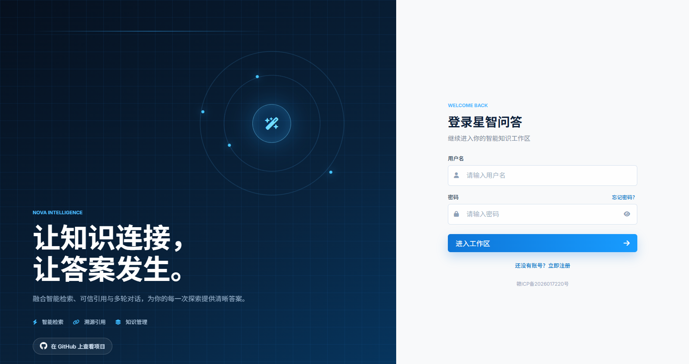
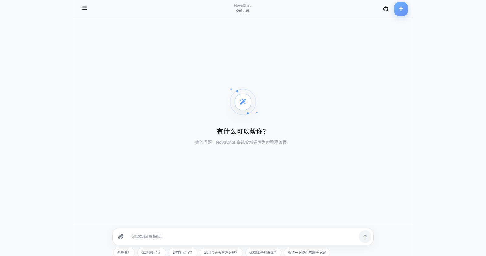
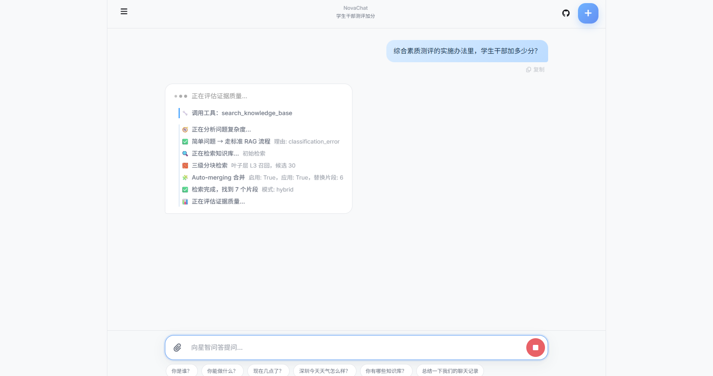
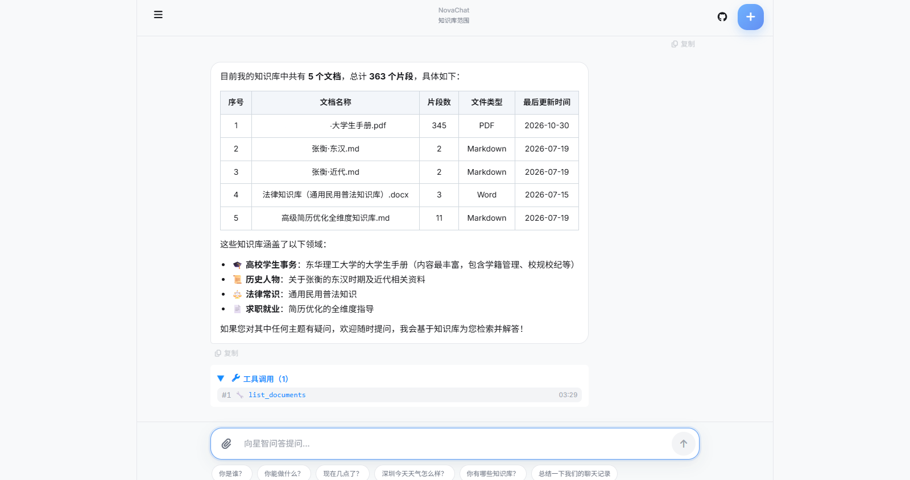
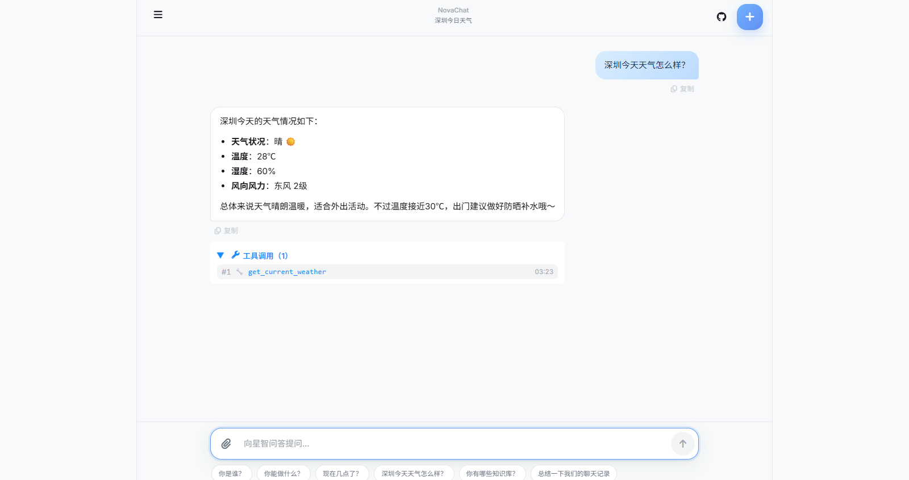
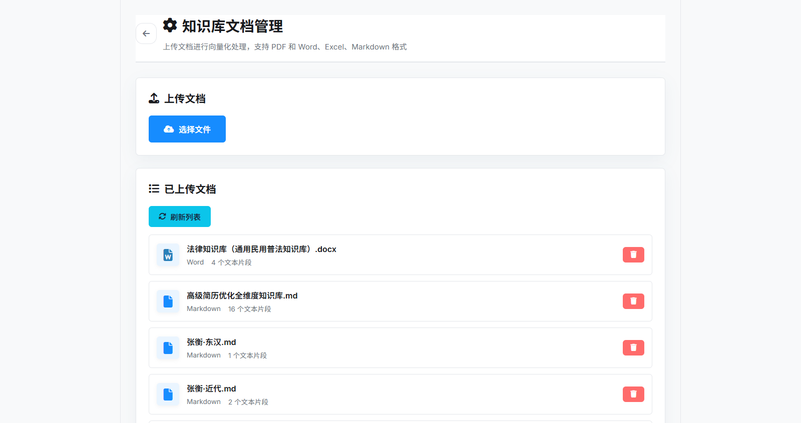
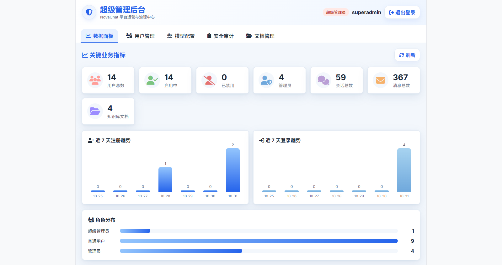
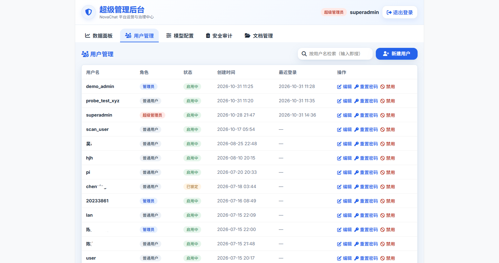
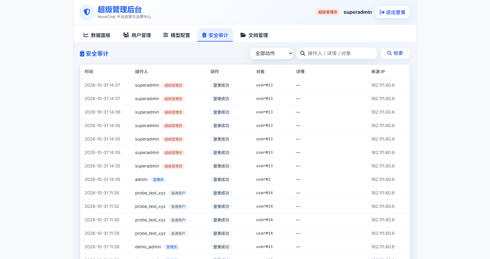
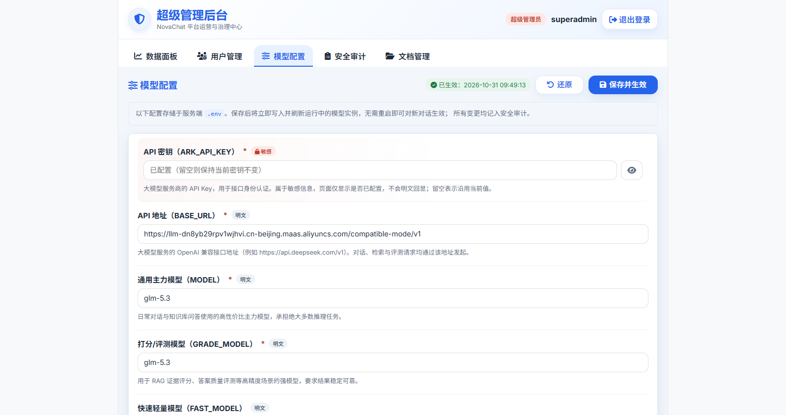

<div align="center">

# ✨ NovaChat（星智问答）

**基于 Corrective RAG 的智能知识问答平台**

融合混合检索、自适应重写、来源引用与多轮对话，为你的每一次探索提供清晰、可信的答案。

[在线体验](http://novachat.top) · [快速开始](#-快速开始) · [功能特性](#-核心特性) · [架构设计](#-整体架构) · [参与贡献](#-贡献)

     

**简体中文**

</div>

---

## 📸 项目展示

| 登录页 | 对话主页 |
| :---: | :---: |
|  |  |

**RAG 思考链路实时可视化** —— 检索、评分、合并、精排全过程透明可见：



**工具调用与知识库问答** —— Agent 自主调用工具，回答结构化呈现：

| 知识库概览 | 实时天气查询 |
| :---: | :---: |
|  |  |

**知识库文档管理**（管理员）—— 上传文档自动分块、向量化入库：



**超级管理后台** —— 用户治理、模型配置、安全审计、文档管理一站式平台治理中心：

| 数据面板 | 用户管理 |
| :---: | :---: |
|  |  |
|  |  |

## 💡 简介

NovaChat（星智问答）是一个基于 **Corrective RAG（纠错型检索增强生成）** 的智能知识问答平台。它不只是简单地"把文档喂给大模型"，而是构建了一条完整的可信检索链路：

- **混合检索**：稠密向量 + Milvus 原生 BM25 稀疏向量，RRF 融合排序，兼顾语义与关键词匹配；
- **自我纠错**：检索结果经 LLM 相关性评分门控，低质召回自动触发 Step-Back / HyDE 查询重写与二次检索；
- **过程透明**：检索、评分、重写、工具调用全过程实时流式展示，每个回答都可溯源。

## 🚀 核心特性

### 智能问答

- **流式输出**：基于 LangGraph `astream` + SSE 逐 token 推送，前端打字机效果；
- **实时思考链路**：检索步骤（Searching → Grading → Rewriting）与工具调用过程在"思考中"气泡内实时可视化，与回答无缝过渡；
- **自适应问题分解**：LLM 自动研判问题复杂度，复杂问题拆解为多个子问题并行检索（LangGraph `Send` API），最终去重合成；
- **会话记忆**：自动摘要长对话注入系统提示，Redis 缓存热点会话，历史记录随时回放；
- **多模态附件**：支持聊天中上传图片（多模态模型）与文档（自动提取正文注入上下文）。

### 检索增强（RAG）

- **Corrective RAG 流水线**：召回 → 相关性评分 → 查询重写（Step-Back / HyDE / Complex 自适应路由）→ 二次召回 → 生成；
- **Milvus 2.5+ 原生 BM25**：服务端中文分词 + 稀疏特征自动提取，零客户端统计负担的 Dense + Sparse 双塔检索；
- **三级分块 + Auto-merging**：L1/L2/L3 滑动窗口切分，叶子块向量化入库，检索命中后自动向上合并父块，兼顾精度与上下文；
- **Jina Rerank 精排**：召回后 API 级重排，`rerank_score` 前端可视化；
- **来源引用**：折叠卡片展示每条引用的 RRF Rank、精排得分、所处层级与页码。

### 工程化能力

- **RBAC 权限**：用户注册/登录、JWT 鉴权、admin / user 角色控制，超级管理后台支持用户治理、审计日志与模型配置；
- **MCP 双向支持**：既可把本地工具暴露为 MCP Server 供 Claude Desktop / Cursor 调用，也可作为客户端接入任意外部 MCP Server；
- **可扩展工具**：天气查询、网络搜索（Firecrawl / Serper / DuckDuckGo 可切换）、计算、时间等内置工具，支持按需扩展；
- **回答终止**：前端 `AbortController` + 后端确定性任务取消，中断即止损，节省 Token。

## 🛠️ 技术栈

| 层次    | 技术                                                                    |
| :---- | :-------------------------------------------------------------------- |
| 后端    | Python 3.12+ · FastAPI · LangChain / LangGraph · SQLAlchemy · Uvicorn |
| 前端    | Vite · Vue 3 (SFC) · TypeScript · Pinia · Axios · Sass                |
| 向量与检索 | Milvus 2.5+（HNSW + SPARSE_INVERTED_INDEX）· RRF 融合 · Jina Rerank       |
| 嵌入    | `BAAI/bge-m3` 本地稠密向量 · Milvus 原生中文 BM25                               |
| 基础设施  | PostgreSQL · Redis · Docker Compose                                   |
| LLM   | 兼容 OpenAI 协议的任意模型（DeepSeek / Doubao 等）                                |

## 📦 快速开始

### 方式一：Docker 一键部署（推荐）

```bash
# 克隆仓库
git clone https://github.com/amd47802574/NovaChat.git
cd NovaChat

# 配置环境变量
cp .env.example .env
# 编辑 .env，填入 ARK_API_KEY、模型名等配置

# 一键启动（基础设施 + 应用）
docker compose -f docker-compose.release.yml up -d

# 浏览器访问
# http://localhost:8000
```

### 方式二：本地开发

**1）启动数据库、缓存和向量库**（封装 Milvus、PostgreSQL、Redis 及其依赖）：

```bash
docker compose up -d
```

**2）安装后端依赖并启动**：

```bash
# 推荐 uv
uv sync
uv run python backend/app.py

# 或 pip
python -m venv .venv
.venv\Scripts\activate        # Windows
pip install -e .
python backend/app.py
```

**3）前端**：

```bash
cd frontend
npm install
npm run build    # 生产构建，由后端静态托管，访问 http://127.0.0.1:8000
npm run dev      # 或开发模式，访问 http://127.0.0.1:3000
```

> 端口说明：PostgreSQL `5432` · Redis `6379` · Milvus `19530` · MinIO `9000/9001` · Attu `8080`

## 🏗️ 整体架构

```
用户提问
    │
    ▼
POST /chat/stream (SSE)
    │
    ▼
FastAPI + LangGraph Agent
    ├── 简单问题 ──► 直接检索 / 通用工具
    └── 复杂问题 ──► LLM 分解子问题 ──► 并行 Sub-Agent（Send API）
              │
              ▼
    ┌──────────────────────────────────────────────┐
    │            Corrective RAG 流水线          │
    │                                          │
    │  retrieve_initial  ← Milvus Hybrid 检索   │
    │        │            (Dense + BM25 + RRF)  │
    │        ▼                                  │
    │  Auto-merging (L3→L2→L1) + Jina Rerank    │
    │        │                                  │
    │        ▼                                  │
    │  grade_documents（相关性评分门控）           │
    │        │                                  │
    │        ├─ yes ──► 生成回答                 │
    │        └─ no ───► rewrite_question        │
    │                   (Step-Back/HyDE/Complex)│
    │                         │                 │
    │                         ▼                 │
    │              retrieve_expanded 二次召回     │
    └────────────────────────────────────────────────┘
              │
              ▼
    流式回答 + RAG Trace + 来源引用
    （PostgreSQL 持久化 + Redis 缓存）
```

## 📁 目录结构

```
NovaChat
├── backend/                 # FastAPI 后端
│   ├── api/                 #   HTTP 路由层（auth / chat / sessions / documents / super_admin）
│   ├── chat/                #   对话域：流式服务、Agent 运行时、请求上下文、会话存储
│   ├── rag/                 #   RAG 核心：LangGraph 工作流、混合检索、Auto-merging
│   ├── indexing/            #   文档入库：分块、嵌入、Milvus 读写、父块 DocStore
│   ├── tools/               #   Agent 工具 + MCP 协议双向适配（server / client）
│   ├── infra/               #   数据库、缓存、鉴权基础设施
│   └── db/ schemas/ jobs/   #   ORM 模型、Pydantic Schema、异步任务
├── frontend/                # Vue 3 + Vite 前端
│   └── src/
│       ├── components/Chat/       # 聊天组件（思考链路、工具调用、来源引用）
│       ├── components/Documents/  # 知识库管理（上传、文档设置）
│       ├── components/SuperAdmin/ # 超级管理后台（用户治理、审计、模型配置）
│       └── stores/                # Pinia 状态（auth / chat / sessions / documents）
├── data/                    # 上传文档与运行数据
├── tests/                   # pytest 测试用例
├── docker-compose.yml       # 基础设施编排（Milvus / PostgreSQL / Redis）
├── docker-compose.release.yml # 完整生产编排（含 app 服务）
└── mcp_config.json          # 外部 MCP Server 接入配置
```

## 🔧 环境变量

复制 `.env.example` 为 `.env` 后按需配置，核心变量：

| 变量                                                  | 说明                                            |
| :-------------------------------------------------- | :-------------------------------------------- |
| `ARK_API_KEY` / `MODEL` / `BASE_URL`                | 大模型 API 与模型名                                  |
| `EMBEDDING_MODEL` / `DENSE_EMBEDDING_DIM`           | 稠密向量模型与维度（需与 Milvus 集合对齐）                     |
| `RERANK_MODEL` / `RERANK_API_KEY`                   | Jina / SiliconFlow 精排配置                       |
| `MILVUS_HOST` / `MILVUS_PORT` / `MILVUS_COLLECTION` | Milvus 连接                                     |
| `DATABASE_URL` / `REDIS_URL`                        | PostgreSQL / Redis 连接                         |
| `JWT_SECRET_KEY` / `ADMIN_INVITE_CODE`              | 鉴权与管理员邀请码                                     |
| `WEB_SEARCH_API`                                    | 网络搜索后端（`firecrawl` / `serper` / `duckduckgo`） |
| `CHAT_VISION_ENABLED`                               | 聊天图片多模态开关（需模型支持）                              |
| `NOVACHAT_MCP_ENABLED`                              | 外部 MCP Server 工具加载开关                          |

## 🌐 在线体验

- **地址**：<http://novachat.top>
- 支持注册自己的账号体验完整功能（知识库管理为管理员权限）
- 站点已备案：赣ICP备2026017220号

## 🤝 贡献

欢迎 Issue 与 PR！开发前请先阅读 [RELEASE\_NOTES.md](RELEASE_NOTES.md) 了解发布形态，本地运行：

```bash
uv sync
uv run pytest tests/ -v     # 运行测试
cd frontend && npm run build # 前端构建（vue-tsc 类型检查）
```

## ⭐ 支持一下

如果这个项目对你有帮助，欢迎点一个 Star！


---

<div align="center">

**NovaChat** · 让知识连接，让答案发生。

</div>
