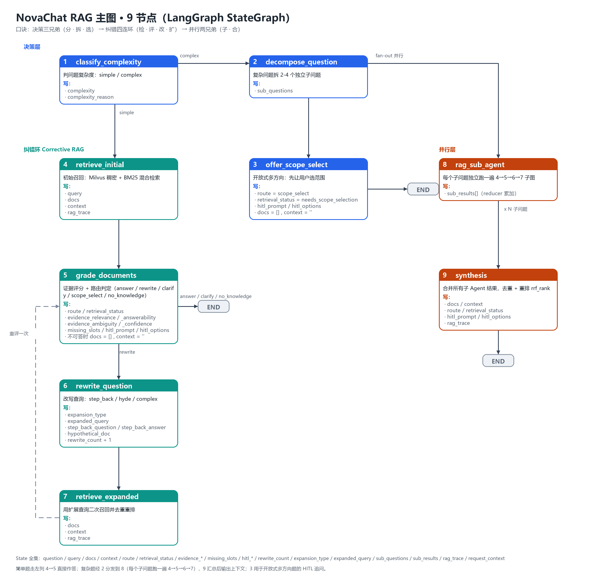

# NovaChat RAG 主图 · 9 节点速记

> 目标：白板/纸上随手能画出这 9 个节点，并随时报出每个节点的输入输出 State 字段。
> 代码位置：`backend/rag/pipeline.py`（`RAGState` 定义在 `pipeline.py:158`，主图构建在 `pipeline.py:1153`）。



## 一、一句话口诀

**决策三兄弟（分 · 拆 · 选） → 纠错四连环（检 · 评 · 改 · 扩） → 并行两兄弟（子 · 合）**

| 层 | 节点 | 作用 |
| :-- | :-- | :-- |
| 决策层 | ① `classify_complexity` | 判简单 / 复杂 |
| 决策层 | ② `decompose_question` | 复杂问题拆子问题 |
| 决策层 | ③ `offer_scope_select` | 开放式多方向 → 先问用户选范围 |
| 纠错环 | ④ `retrieve_initial` | 初始召回 |
| 纠错环 | ⑤ `grade_documents` | 证据评分 + 路由 |
| 纠错环 | ⑥ `rewrite_question` | 改写查询（step_back / hyde / complex） |
| 纠错环 | ⑦ `retrieve_expanded` | 扩展查询二次召回 |
| 并行层 | ⑧ `rag_sub_agent` | 每个子问题跑一遍 ④⑤⑥⑦ 子图 |
| 并行层 | ⑨ `synthesis` | 合并去重 + 重排 |

## 二、白板手绘版（照着画就行）

```text
                        ┌────────────────────┐
                        │ ① classify         │ ← 简单?
                        │    complexity      │
                        └─────────┬──────────┘
                     simple ┌─────┴─────┐ complex
              ┌──────────────┘           └───────────────┐
              ▼                                          ▼
      ┌───────────────┐                       ┌──────────────────┐
      │ ④ retrieve    │                       │ ② decompose      │
      │    initial    │                       │    question       │
      └───────┬───────┘                       └────┬────────┬────┘
              │                     开放式复杂题      │        │ Send 并行
              │                  ┌─────────────────┘        ▼
              │                  ▼                 ┌──────────────────┐
              │          ┌───────────────┐         │ ⑧ rag_sub_agent  │ ×N
              │          │ ③ offer      │         └────────┬─────────┘
              │          │    scope_     │                  │
              │          │    select     │                  ▼
              │          └───────┬───────┘         ┌──────────────────┐
              │                  │ END             │ ⑨ synthesis      │
              ▼                  ▼                 └────────┬─────────┘
      ┌───────────────┐   ┌─────────┐                     │ END
      │ ⑤ grade      │   │  END    │                     ▼
      │    documents  │   └─────────┘               ┌─────────┐
      └──┬────────┬──┘                             │  END    │
   answer/clarify │ rewrite                        └─────────┘
    ┌─────────┐   ▼
    │  END    │  ┌────────────────┐
    └─────────┘  │ ⑥ rewrite      │
                 │    question     │
                 └───────┬────────┘
                         ▼
                 ┌────────────────┐
                 │ ⑦ retrieve     │
                 │    expanded     │
                 └───────┬────────┘
                         └ ┄ ┄ ┄ ┄ ┄► 回到 ⑤（重评一次，rewrite_count 最多 1 次）
```

连线上要标的判断条件（背这 5 条就够）：

1. ① → ④：`complexity == "simple"`
2. ① → ②：`complexity == "complex"`
3. ② → ③：开放式题（"怎么 / 如何 / 有哪些"）且候选 ≥ 2 → 走 HITL 选范围
4. ② → ⑧：`Send` 分发子问题；⑤ → ⑥：`route == "rewrite"`；⑥ → ⑦ → ⑤ 构成一次回环
5. ⑤ → END、③ → END、⑨ → END：结束并产出最终 `docs` + `context`

## 三、9 个节点的输入 / 输出 State 字段

> "读" = 节点函数从 state 里取的键；"写" = 节点 `return` 出去的键（LangGraph 只合并返回的键）。

### ① `classify_complexity` — `pipeline.py:833`

- 读：`question`、`request_context`
- 写：`complexity`（`simple` / `complex`）、`complexity_reason`
- 出边：`simple → ④`；`complex → ②`

### ② `decompose_question` — `pipeline.py:864`

- 读：`question`、`request_context`
- 写：`sub_questions`（2-4 条；模型不可用时退化为原问题 1 条）
- 出边：开放式复杂题 → ③；否则 → ⑧（`Send`）

### ③ `offer_scope_select` — `pipeline.py:920`

- 读：`question`、`sub_questions`、`request_context`、已有 `rag_trace`
- 写：`route = "scope_select"`、`retrieval_status = "needs_scope_selection"`、`hitl_prompt`、`hitl_options`、`docs = []`、`context = ""`、`rag_trace`
- 出边：END（挂起等用户选范围，用户补充后走 `resume_rag_from_hitl`）

### ④ `retrieve_initial` — `pipeline.py:319`

- 读：`question`、`request_context`
- 写：`query`（= question）、`docs`（召回片段 list）、`context`（`_format_docs` 拼好的文本）、`rag_trace`（含 `retrieved_chunks` / `initial_retrieved_chunks` / `retrieval_stage="initial"`）
- 出边：⑤

### ⑤ `grade_documents` — `pipeline.py:565`

- 读：`docs`、`context`、`question`、`rewrite_count`、`is_sub_agent`、`request_context`、`rag_trace`
- 写：`route`、`retrieval_status`、`evidence_relevance`、`evidence_answerability`、`evidence_ambiguity`、`evidence_confidence`、`missing_slots`、`hitl_prompt`、`hitl_options`、`rag_trace`
- 条件写：当 `route ∈ {no_knowledge, clarify, scope_select}` 时额外写 `docs = []`、`context = ""`
- 出边：`route == "rewrite"` → ⑥；其余 → END
- 备注：`rag_trace` 里还写 `grade_score` / `grade_route` / `rewrite_needed` / `evidence_reason` 等前端兼容字段

### ⑥ `rewrite_question` — `pipeline.py:665`

- 读：`question`、`rewrite_count`、`request_context`、`rag_trace`
- 写：`expansion_type`（`step_back` / `hyde` / `complex`）、`expanded_query`、`step_back_question`、`step_back_answer`、`hypothetical_doc`、`rewrite_count`（+1）、`rag_trace`
- 条件写：若 `rewrite_count >= 1`（预算用完）→ 改写为 `route = "no_knowledge"`、`retrieval_status = "no_knowledge"`、`docs = []`、`context = ""`
- 出边：⑦

### ⑦ `retrieve_expanded` — `pipeline.py:740`

- 读：`expansion_type`、`expanded_query`、`hypothetical_doc`、`question`、`request_context`、`rag_trace`
- 写：`docs`（多路召回合并去重）、`context`、`rag_trace`（`retrieval_stage="expanded"`）
- 出边：⑤（**重评一次**，这是 Corrective RAG 的回环）

### ⑧ `rag_sub_agent` — `pipeline.py:1133`（子图 `pipeline.py:1106`）

- 读：`question`（子问题）、`request_context`；内部把整个 state 丢给子图 ④→⑤→⑥→⑦ 跑一遍
- 写：`sub_results`（`Annotated[List[dict], operator.add]`，并行分支各自累加一项）：`{question, docs, retrieval_status, route, rag_trace}`
- 出边：⑨

### ⑨ `synthesis` — `pipeline.py:966`

- 读：`sub_results`、`question`、`sub_questions`、`request_context`、`rag_trace`
- 写：`docs`（去重 + 重排 `rrf_rank`）、`context`、`route`、`retrieval_status`、`hitl_prompt`、`hitl_options`、`rag_trace`（含 `sub_traces` / `hitl_candidate_chunks`）
- 出边：END

## 四、State 字段全表（`RAGState`，`pipeline.py:158`）

| 分组 | 字段 |
| :-- | :-- |
| 问题 / 查询 | `question`、`query`、`expanded_query`、`step_back_question`、`step_back_answer`、`hypothetical_doc` |
| 检索结果 | `docs`、`context` |
| 路由与状态 | `route`、`retrieval_status`、`expansion_type`、`rewrite_count` |
| 证据评分 | `evidence_relevance`、`evidence_answerability`、`evidence_ambiguity`、`evidence_confidence`、`missing_slots` |
| 人机协同 | `hitl_prompt`、`hitl_options` |
| 复杂度 / 并行 | `complexity`、`complexity_reason`、`sub_questions`、`is_sub_agent`、`sub_results`（reducer 累加） |
| 过程与上下文 | `rag_trace`、`request_context`（`ChatRequestContext`，负责把 RAG 步骤推到 SSE） |

- `route` 取值：`answer` / `rewrite` / `clarify` / `scope_select` / `no_knowledge`
- `retrieval_status` 取值：`answerable` / `partial` / `needs_rewrite` / `needs_clarification` / `needs_scope_selection` / `no_knowledge`

## 五、记忆与复述要点

- **主线一句话**：先判复杂度 → 简单题直接走"检索 → 评分 →（必要时）改写 → 再检索"；复杂题先拆题并行跑子图，再合并。
- **唯一的环**：`④ → ⑤ → ⑥ → ⑦ → ⑤`，且 `rewrite_count` 上限为 1，第二次评分仍不行就转 `clarify` 或 `no_knowledge`。
- **唯一的并发点**：② 用 `Send` 一次发 N 个 `rag_sub_agent`，结果靠 `sub_results` 的 `operator.add` 汇总到 ⑨。
- **唯一的 HITL 分支**：③ 以及 ⑤ 判出的 `clarify` / `scope_select`，都会把 `hitl_prompt` + `hitl_options` 交给前端追问。
- **前端能看到的字段**基本都在 `rag_trace` 里（`retrieval_stage`、`grade_route`、`rerank_score`、`hitl_candidate_chunks`…），改 trace 就改 UI。

## 六、重新生成这张图

```bash
uv run --with pillow python docs/draw_rag_graph.py   # 输出 assets/rag-graph.png
```
